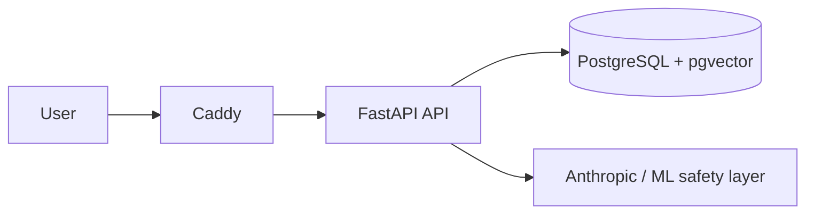

# Counselling Practice Platform MVP

## Architecture

## Run locally

1. Copy `.env.example` to `.env` and adjust values.
2. Start the stack:
   `make up`
3. Open the app through Caddy at http://localhost
4. API health check: http://localhost/health

## Security and guardrails

- Demo banner is rendered on every client page in the frontend shell.
- Safety screening runs before any AI output is generated.
- Crisis messages are fixed and never model-written.
- The message shows Tele-MANAS 14416 and a therapist alert.
- Post-check rejects diagnostic or supplement advice based on a static policy.

## Evaluation snapshot

| Check | Result |
| --- | --- |
| Safety hit rate on 30 phrases | 100% |
| Access-control tests | passing |
| Claims screening | passing |

## Roadmap

- Payments and scheduling integration
- Calendar sync and automated reminders
- Meeting bot notes capture
- DPDP review and retention policy

## Demo users

- Admin: admin@example.com / admin123
- Practice owner: owner@example.com / owner123
- Therapist: therapist@example.com / therapist123
- Client: client@example.com / client123
