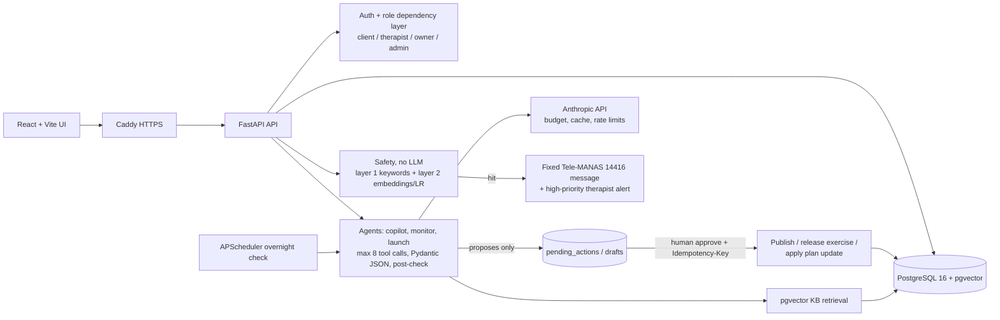

# Counselling Practice Platform MVP

## Architecture

Publishing requires owner approval; public visibility also requires admin verification.

## Run locally

1. Copy `.env.example` to `.env` and adjust values.
2. Start the stack:
   `make up`
3. Open the app through Caddy at http://localhost
4. API health check: http://localhost/health

## Security and guardrails

- Demo banner is rendered on every client page in the frontend shell.
- Safety screening runs before any AI output is generated.
- Crisis messages are fixed and never model-written.
- The message shows Tele-MANAS 14416 and a therapist alert.
- Post-check rejects diagnostic or supplement advice based on a static policy.

## Evaluation snapshot

All numbers are from the test suite (`make test`) with the LLM mocked; synthetic data only. Risk and RAG-calibration tables below use the real embedder.

| Check | Result |
| --- | --- |
| 30-phrase safety suite (EN + HI, `tests/test_milestone_5b.py`) | risk 10/10 get the fixed crisis message; benign 6/6 do not; 14 diagnosis / supplement / prompt-injection requests: 14/14 not mistaken for risk (layer 1), 14/14 compliant model replies rejected by the post-check |
| Claims bait (20 generated pages, 10 with bait owner input, model check set to approve everything) | banned claims delivered to owner: 0/20; bait pages revised: 10/10; clean pages revised: 0/10 |
| Access-control tests | passing (cross-client, cross-therapist, owner to clinical, cross-client retrieval) |

Notes: the claims check is deterministic (regex) plus an optional model check; the bait test found five phrases the regex missed ("quick fix", "risk-free", "permanent relief", "always works", "100 percent") and fallback copy that itself said "quick fix". Both were fixed. The Hindi post-check (diagnosis and medicine/supplement words, native and romanised) is a short word list, not a classifier; it will miss paraphrases. Layer 2 is not part of the 30-phrase test because the test embedder is lexical; layer 2 numbers are in the risk table below.

## Risk triage evaluation (SYNTHETIC, demonstration only)

Two layers, either one triggers the fixed crisis message (Tele-MANAS 14416 / 1-800-891-4416) and a high-priority therapist alert. No model call, no API key needed.
Layer 1: keyword/pattern match (EN/HI/KN, native + romanised). Layer 2: multilingual-e5-small embeddings + logistic regression (threshold 0.5), trained on 60 hand-written synthetic phrases (30 risk / 30 non-risk incl. idioms such as "this deadline is killing me").
Short-text rule: layer 2 does not run on inputs under 4 words or on numeric/date values (and `risk_scan(..., layer2=False)` skips it for single-choice fields); layer 1 always runs, so "I want to die" is still caught. The table below applies this rule.
Held-out = 18 of the 60 phrases (stratified 70/30 split, fixed seed), real embedder. Reproduce: `docker compose run --rm api python -m backend.scripts.eval_risk`.

| Detector | Precision | Recall |
| --- | --- | --- |
| Layer 1 only | 1.00 | 0.89 |
| Layer 2 only (short-text rule) | 0.67 | 0.44 |
| Layer 1 OR layer 2 (deployed) | 0.82 | 1.00 |

Hard negatives (15 benign phrases with risk-like words, `make risk-report`): layer 1 fires on 0/15 (asserted in tests). Layer 2 (report only) fires on 1/15 ("I'm dying to see my friends", 0.59 vs threshold 0.5); the next-highest are 0.48 ("I'd die of embarrassment...", "I'm starving to death...") and 0.44, so several sit near the threshold. Expect some false alerts from idioms; accepted on purpose.

Independent check: if `tests/risk_independent.csv` exists (one risk phrase per row, first column), `make risk-report` prints every phrase the scan misses. Not a failing test. The file is not present yet.

Caveats: 18 held-out phrases is far too small for any real claim, and layer 1's patterns were written by the same author as the phrases. False alerts are accepted on purpose: a missed risk costs more than an unnecessary alert. Not clinically validated.

## RAG calibration

Real `multilingual-e5-small` (`query: ` / `passage: ` prefixes), top-1 cosine similarity against the 12-entry KB (each entry includes an "Also described as" section of lay phrases).
Reproduce with `make kb` then `make calibrate`. **The threshold must be recalibrated whenever KB entries change** (e.g. after clinician edits): rerun `make calibrate` and update `KB_MIN_SIMILARITY` and the recorded scores in `tests/test_rag.py`.

| In-domain query | Top-1 sim | Full-text hit |
| --- | --- | --- |
| anxiety at night | 0.839 | yes |
| can't stop worrying | 0.830 | yes |
| low motivation | 0.846 | yes |
| breathing for panic | 0.868 | yes |
| trouble falling asleep | 0.859 | yes |
| feeling overwhelmed and stressed | 0.839 | yes |
| grounding when I feel panicky | 0.880 | yes |
| how to challenge negative thoughts | 0.850 | yes |
| I feel lonely and want support | 0.817 | yes |
| managing intense emotions | 0.860 | yes |
| mind racing at night | 0.791 | yes |
| no energy to do anything | 0.818 | no |
| can't switch off before bed | 0.851 | yes |
| Client reports lying awake for hours with worries about exams. Sleep has been around five hours. She tries to scroll on her phone in bed. | 0.827 | yes |
| Client describes withdrawing from friends and staying in most days. Mood is low and he says nothing feels worth doing. Homework on activity scheduling was not attempted. | 0.859 | yes |
| Client had a panic episode on the bus this week, heart racing and tight chest. Wants something to use in the moment. | 0.838 | yes |
| Client feels intense anger after arguments and acts rashly. Struggles to name what she is feeling. | 0.831 | yes |
| Client faces several work and money problems at once and feels stuck. Does not know where to begin. | 0.841 | yes |
| Client has little contact with family and says there is no one to talk to. Feels like a burden. Scores unchanged over two weeks. | 0.844 | yes |
| Client repeatedly thinks 'I will fail everything' before presentations and spirals. Wants to examine these thoughts. | 0.835 | yes |

| Out-of-domain query | Top-1 sim | Full-text hit |
| --- | --- | --- |
| best pizza recipe | 0.805 | no |
| football score | 0.798 | no |
| how to change a car tyre | 0.801 | no |
| weather in Paris tomorrow | 0.761 | yes |
| stock market news | 0.782 | no |
| cheap flights to Goa | 0.749 | no |
| python list comprehension | 0.821 | yes |
| latest smartphone reviews | 0.804 | yes |
| how to bake sourdough bread | 0.798 | no |
| cricket world cup schedule | 0.773 | no |
| sleep tracker app reviews | 0.832 | yes |
| gym workout plan | 0.844 | yes |
| how to file taxes | 0.825 | no |
| best mattress to buy online | 0.814 | no |
| how to learn guitar chords | 0.811 | no |
| meditation app subscription price | 0.818 | no |
| yoga mat sale near me | 0.772 | yes |
| Summarise the quarterly sales report and list the top three regions by revenue. Include a chart of monthly growth. | 0.796 | yes |
| Write a cover letter for a software engineer job at a bank. Mention five years of Java experience. | 0.803 | no |
| Plan a three-day trip to Jaipur with hotels and restaurants. Budget is around twenty thousand rupees. | 0.780 | yes |

Result: in-domain 0.791-0.880, out-of-domain 0.749-0.844. The sets **overlap** (margin = min in-domain - max out-of-domain = **-0.053**), because near-miss queries such as "gym workout plan" (0.844) and "sleep tracker app reviews" (0.832) score above weaker in-domain phrases like "mind racing at night" (0.791). The script picks the threshold with best balanced accuracy and widest local gap: `KB_MIN_SIMILARITY` = **0.826** (gap around it only 0.002), giving 17/20 in-domain pass and 2/20 out-of-domain pass (false passes: "gym workout plan", "sleep tracker app reviews"). Full-text hits do not separate the sets. Similarity alone cannot cleanly gate near-miss queries; the copilot's citation validator and therapist review remain the backstop.

## Roadmap

- Payments and scheduling integration
- Calendar sync and automated reminders
- Meeting bot notes capture
- DPDP review and retention policy

## Demo data and logins

`make seed` (idempotent, loads the KB, creates availability slots for the next 14 days for each therapist and refreshes expired unbooked ones on every rerun, `make seed ARGS=--check` also prints retrieval margins with the real embedder). All people are fictional.

| Role | Login | Password | Notes |
|---|---|---|---|
| Admin | admin@example.com | admin123 | verify toggle |
| Practice owner | owner@example.com | owner123 | Demo Calm Minds Practice (published + verified) |
| Practice owner | owner2@example.com | owner123 | Demo Harbour Counselling (draft) |
| Therapist | therapist@example.com | therapist123 | clients Alpha, Beta |
| Therapist | therapist2@example.com | therapist123 | client Gamma |
| Therapist | therapist3@example.com | therapist123 | client Delta (practice 2, unverified) |
| Client | client@example.com | client123 | Alpha: PHQ-9/GAD-7 plateau, 1 of 4 exercises done, racing thoughts at night |
| Client | client2@example.com / client3@example.com / client4@example.com | client123 | improving, no alerts |

## Monitoring (overnight check)

Nightly APScheduler job (21:00 UTC, `OVERNIGHT_HOUR_UTC`; single worker plus a Postgres advisory lock) or `POST /therapist/overnight-check`. Code, not the model, flags per client: PHQ-9/GAD-7 slope over 14 days better than -1 point/week not reached (needs two readings at least 7 days apart, latest score 5 or more), under 50% of exercises completed in 14 days (2 or more assigned), a plan goal with no keyword overlap in the last 3 session notes. The model (`MODEL_FAST`, cached, 400 tokens, Pydantic-validated, diagnosis/medication post-check) only drafts the plan-update wording; without AI, or for a risk-flagged client, a fixed template is used. Each finding makes an alert (unique per client, date, type) and one `apply_plan_update` pending action; only the assigned therapist's approval creates a new `case_plans` version, and only if the plan has not changed since the draft. The approved draft is stored in `case_plans.update_notes` (shown as "AI-drafted, approved by <therapist> on <date>"); the therapist-written formulation is never edited by AI text.

## Security notes

- `DEMO_MODE` must be `0` for any real use. When `1`, `/auth/demo-login` logs in as seeded demo accounts (never admin) without a password.
- `/auth/register` accepts only `client`, `therapist`, `practice_owner`; unknown fields are rejected. Therapists and practices start unverified and stay out of public lists until an admin verifies them.
- Create admins only via `make create-admin EMAIL=you@example.com PASSWORD=...` (or the seed script).
