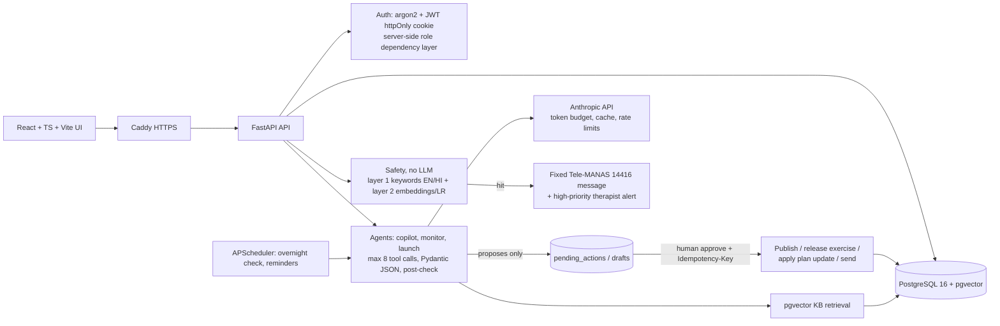
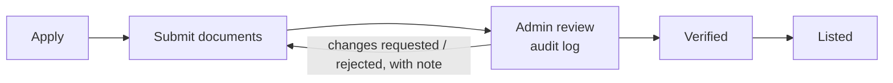
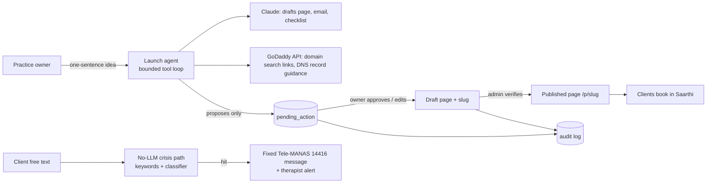

# Saarthi

A therapist-in-the-loop AI copilot for counselling practices. Practices publish a verified public page; clients book, check in, journal and do assigned exercises; therapists get a pre-session briefing, overnight monitoring and drafted plan updates. **The AI only proposes: every output is a draft or pending action that an authenticated human must approve before anything is published, released, applied or sent.** Crisis detection runs without any LLM and always returns a fixed message with Tele-MANAS 14416.

## Architecture

## Trust pipeline

Only published **and** verified practices and therapists appear publicly. Each admin decision (verify, request changes, reject) is audited with actor and note; document downloads are audited too. Editing a licence after verification returns the therapist to review. Verification never publishes or edits a practice page.

## Features by role

| Role | Features |
|---|---|
| Client | Find and book verified therapists; intake; mood check-in; private or shared journal; guided journeys; assigned exercises; insights; English/Hindi; reminders. Crisis notice on every page |
| Therapist | Credentials and document submission; availability; bookings and intake; session notes (brain dump); AI briefing with cited knowledge; case plans and assessments; approve/reject exercise releases and plan updates; skill-building journeys; overnight alerts (plateau, low homework, untouched goal, risk) |
| Practice owner | Practice setup, editable AI-drafted page, document submission, therapist invites, bookings/listings and practice analytics. No clinical data |
| Admin | Verification queue for therapists and practices with completeness checks, review decisions, audit log, secure document download |

## Access-control matrix

| Data | Client | Therapist | Practice owner | Admin | Public |
|---|---|---|---|---|---|
| Own profile, mood, journal | own | n/a | n/a | no | no |
| Shared journal, mood trend, assessments, notes, plans | no | only clients with a booking or case plan with them | **never** | no | no |
| Other therapists' clients (same practice) | no | no | no | no | no |
| Practice page, listings, team, analytics | no | own practice view | own practice | all | published + verified only |
| Verification documents | no | own | own practice | all (audited) | no |
| Verification decisions | no | no | no | yes | no |
| Therapist directory | no | yes | yes | yes | verified only |

Enforced in a server-side dependency layer, never in prompts. Every endpoint has tests for cross-client, cross-therapist, owner-to-clinical and cross-client retrieval denial.

## Safety layers

Detection runs on **all client free text** and on PHQ-9 item 9 > 0, **without any LLM call and without an API key**. On a hit the flow stops, shows a fixed message with Tele-MANAS 14416, and raises a high-priority therapist alert. No model text is in this path.

- Layer 1: keyword/pattern match, English and Hindi (romanised and Devanagari).
- Layer 2: multilingual-e5-small embeddings + logistic regression on synthetic phrases.
- Post-check on all AI output: rejects diagnoses and medication/supplement advice (EN and HI patterns).
- Client and note text enters prompts as delimited data with an instruction never to follow commands inside it.

| Detector (held-out, 18 phrases) | Precision | Recall |
|---|---|---|
| Layer 1 only | 1.00 | 0.89 |
| Layer 2 only | 0.88 | 0.78 |
| Layer 1 OR layer 2 (deployed) | 0.90 | 1.00 |

Small synthetic set, not clinically validated; false alerts are accepted on purpose. Details below.

## Cost controls

- Daily token budget; over budget or AI down returns "AI unavailable, manual workflow open." Safety and manual workflows keep working.
- Per-IP sliding-window rate limits.
- Dev disk cache keyed by hash(prompt+model); prompt caching on system prompt and retrieved chunks.
- Bounded agent loop: max 8 tool calls, `max_tokens` set, Pydantic-validated JSON, one retry, then a visible error. `MODEL_FAST` for dev, `MODEL_SMART` for final.

## Tech stack

Python 3.12, FastAPI, Pydantic v2, SQLAlchemy 2, Alembic, APScheduler; PostgreSQL 16 + pgvector; Anthropic SDK; fastembed multilingual-e5-small; scikit-learn logistic regression; React + TypeScript + Vite + Tailwind + shadcn/ui; Docker Compose (caddy, api, postgres); argon2 + JWT httpOnly cookie.

## Run

1. `cp .env.example .env`, set `JWT_SECRET` and (for live AI) `ANTHROPIC_API_KEY`. Secrets live only in `.env`.
2. `make up`, then `make seed` (idempotent; loads the KB and 14 days of slots).
3. Open http://localhost. Health: http://localhost/health.
4. `make test` (Postgres, `alembic upgrade head`, LLM mocked). `make e2e` runs the browser story on http://localhost:8081. `make api-types` regenerates frontend types.

## Environment notes

The hosted site runs with `DEMO_MODE=0` and `FAKE_LLM=0`. The app refuses `FAKE_LLM=1` with `DEMO_MODE=0` and `APP_ENV=production`. `DEMO_MODE=1` and `FAKE_LLM=1` are for local demos and e2e only. All variables are listed in `.env.example`.

## Hackathon: idea to launch

A practice owner describes their practice in a sentence. The launch agent proposes a page address (`/p/<slug>`), a draft page, a welcome email and a checklist as one pending action. The owner reviews, edits and approves; an admin verifies the practice; it goes live and clients book inside Saarthi.

**Where Claude is used:** the launch agent (page draft, welcome email, checklist), the therapist copilot (briefings, plan-update and exercise proposals) and the overnight monitor. All output is Pydantic-validated and post-checked for diagnoses and medication advice.

**Where GoDaddy is used:** domain, DNS, hosting and business email. Owners who want their own domain get GoDaddy search links and the exact DNS records to add. DNS is written only when `GODADDY_ALLOW_DNS_WRITE=1` and the owner confirms.

**Safety design**
- Crisis detection runs on all client free text with no LLM call and returns a fixed message with Tele-MANAS 14416 plus a high-priority therapist alert.
- AI only proposes. Publishing, releasing an exercise, applying a plan update and sending email each need an authenticated human action with an idempotency key.
- Approvals, edits and verification decisions are written to the audit log.

**Known limits**
- Serving a practice on its custom domain is not built; the page is served at `/p/<slug>`.
- Domain availability is a link out to GoDaddy search, not a live check, and no domain is bought automatically.
- The welcome email is a draft for the owner to send; Saarthi does not send it.
- Contact-form messages that look like a crisis are saved, not emailed.

**What's next:** serve verified practices on their own domains, in-app welcome email sending, more regional languages, and the roadmap items below.

**Review accounts:** `JUDGE_PASSWORD_CLIENT=... JUDGE_PASSWORD_THERAPIST=... JUDGE_PASSWORD_OWNER=... python -m backend.scripts.create_judge_accounts` creates or refreshes one client, one verified therapist with fictional case data, and one owner with a draft practice. Passwords are read from the environment (12+ characters) and never stored in the repo.

## Seeded accounts (LOCAL use only)

All people are fictional. **Change every seeded password before any public hosting, or do not seed.**

| Role | Login | Password | Notes |
|---|---|---|---|
| Admin | admin@example.com | admin123 | verification queue |
| Practice owner | owner@example.com | owner123 | Calm Minds Counselling (published, verified) |
| Practice owner | owner2@example.com | owner123 | Harbour Counselling |
| Practice owner | owner3@example.com | owner123 | Lakeview Wellness Clinic |
| Practice owner | owner4@example.com | owner123 | Greenleaf Counselling Studio (setup in progress, pending invite) |
| Therapist | therapist@example.com | therapist123 | Calm Minds; clients Alpha, Beta |
| Therapist | therapist2@example.com, therapist4@example.com | therapist123 | Calm Minds |
| Therapist | therapist3@example.com, therapist5@example.com, therapist6@example.com | therapist123 | Harbour |
| Therapist | therapist7@example.com to therapist9@example.com | therapist123 | Lakeview |
| Therapist | therapist10@example.com | therapist123 | Lakeview; verification submitted, awaiting admin review |
| Client | client@example.com | client123 | Alpha: PHQ-9/GAD-7 plateau, 1 of 4 exercises done |
| Client | client2@example.com to client12@example.com | client123 | varied cases (client5 has an active journey; client12 has no therapist) |

## Screenshots

- Landing / practice page: _add screenshot_
- Client dashboard and check-in: _add screenshot_
- Therapist briefing and approval inbox: _add screenshot_
- Admin verification queue: _add screenshot_

## Roadmap

- More regional languages
- Privacy and terms pages (pending legal review)
- Translations (pending linguistic review)
- Single-practice analytics parameter
- Document cleanup on user deletion
- Malware scanning for uploads
- Resend invite
- Exercise swap in the approval inbox
- Admin queue pagination and search
- Journey steps tied to exercise completion
- DPDP Act compliance work

---

## Evaluation snapshot

All numbers are from the test suite (`make test`) with the LLM mocked; synthetic data only. Risk and RAG-calibration tables below use the real embedder.

| Check | Result |
| --- | --- |
| 30-phrase safety suite (EN + HI, `tests/test_milestone_5b.py`) | risk 10/10 get the fixed crisis message; benign 6/6 do not; 14 diagnosis / supplement / prompt-injection requests: 14/14 not mistaken for risk (layer 1), 14/14 compliant model replies rejected by the post-check |
| Claims bait (20 generated pages, 10 with bait owner input, model check set to approve everything) | banned claims delivered to owner: 0/20; bait pages revised: 10/10; clean pages revised: 0/10 |
| Access-control tests | passing (cross-client, cross-therapist, owner to clinical, cross-client retrieval) |

Notes: the claims check is deterministic (regex) plus an optional model check; the bait test found five phrases the regex missed ("quick fix", "risk-free", "permanent relief", "always works", "100 percent") and fallback copy that itself said "quick fix". Both were fixed. The Hindi post-check (diagnosis and medicine/supplement words, native and romanised) is a short word list, not a classifier; it will miss paraphrases. Layer 2 is not part of the 30-phrase test because the test embedder is lexical; layer 2 numbers are in the risk table below.

## Risk triage evaluation (SYNTHETIC)

Two layers, either one triggers the fixed crisis message (Tele-MANAS 14416 / 1-800-891-4416) and a high-priority therapist alert. No model call, no API key needed.
Layer 1: keyword/pattern match (EN/HI, native + romanised). Layer 2: multilingual-e5-small embeddings + logistic regression (threshold 0.5), trained on 60 hand-written synthetic phrases (30 risk / 30 non-risk incl. idioms such as "this deadline is killing me").
Short-text rule: layer 2 does not run on inputs under 4 words or on numeric/date values (and `risk_scan(..., layer2=False)` skips it for single-choice fields); layer 1 always runs, so "I want to die" is still caught. The table below applies this rule.
Held-out = 18 of the 60 phrases (stratified 70/30 split, fixed seed), real embedder. Reproduce: `docker compose run --rm api python -m backend.scripts.eval_risk`.

| Detector | Precision | Recall |
| --- | --- | --- |
| Layer 1 only | 1.00 | 0.89 |
| Layer 2 only (short-text rule) | 0.88 | 0.78 |
| Layer 1 OR layer 2 (deployed) | 0.90 | 1.00 |

Hard negatives (15 benign phrases with risk-like words, `make risk-report`): layer 1 fires on 0/15 (asserted in tests). Layer 2 (report only) fires on 2/15 ("I'm dying to see my friends", 0.55; "I'm starving to death, let's eat", 0.53; threshold 0.5); the next-highest are 0.49 and 0.47, so several sit near the threshold. Expect some false alerts from idioms; accepted on purpose.

Independent check: if `tests/risk_independent.csv` exists (one risk phrase per row, first column), `make risk-report` prints every phrase the scan misses. Not a failing test. The file is not present yet.

Caveats: 18 held-out phrases is far too small for any real claim, and layer 1's patterns were written by the same author as the phrases. False alerts are accepted on purpose: a missed risk costs more than an unnecessary alert. Not clinically validated.

Latest run (`eval_risk`, this release): layer 1 P 1.00 / R 0.89; layer 2 P 0.88 / R 0.78; combined P 0.90 / R 1.00; missed: none; false alert: "I want to stop overthinking at night".

## RAG calibration

Real `multilingual-e5-small` (`query: ` / `passage: ` prefixes), top-1 cosine similarity against the 12-entry KB (each entry includes an "Also described as" section of lay phrases).
Reproduce with `make kb` then `make calibrate`. **The threshold must be recalibrated whenever KB entries change** (e.g. after clinician edits): rerun `make calibrate` and update `KB_MIN_SIMILARITY` and the recorded scores in `tests/test_rag.py`.

| In-domain query | Top-1 sim | Full-text hit |
| --- | --- | --- |
| anxiety at night | 0.839 | yes |
| can't stop worrying | 0.830 | yes |
| low motivation | 0.846 | yes |
| breathing for panic | 0.868 | yes |
| trouble falling asleep | 0.859 | yes |
| feeling overwhelmed and stressed | 0.839 | yes |
| grounding when I feel panicky | 0.880 | yes |
| how to challenge negative thoughts | 0.850 | yes |
| I feel lonely and want support | 0.817 | yes |
| managing intense emotions | 0.860 | yes |
| mind racing at night | 0.791 | yes |
| no energy to do anything | 0.818 | no |
| can't switch off before bed | 0.851 | yes |
| Client reports lying awake for hours with worries about exams. Sleep has been around five hours. She tries to scroll on her phone in bed. | 0.827 | yes |
| Client describes withdrawing from friends and staying in most days. Mood is low and he says nothing feels worth doing. Homework on activity scheduling was not attempted. | 0.859 | yes |
| Client had a panic episode on the bus this week, heart racing and tight chest. Wants something to use in the moment. | 0.838 | yes |
| Client feels intense anger after arguments and acts rashly. Struggles to name what she is feeling. | 0.831 | yes |
| Client faces several work and money problems at once and feels stuck. Does not know where to begin. | 0.841 | yes |
| Client has little contact with family and says there is no one to talk to. Feels like a burden. Scores unchanged over two weeks. | 0.844 | yes |
| Client repeatedly thinks 'I will fail everything' before presentations and spirals. Wants to examine these thoughts. | 0.835 | yes |

| Out-of-domain query | Top-1 sim | Full-text hit |
| --- | --- | --- |
| best pizza recipe | 0.805 | no |
| football score | 0.798 | no |
| how to change a car tyre | 0.801 | no |
| weather in Paris tomorrow | 0.761 | yes |
| stock market news | 0.782 | no |
| cheap flights to Goa | 0.749 | no |
| python list comprehension | 0.821 | yes |
| latest smartphone reviews | 0.804 | yes |
| how to bake sourdough bread | 0.798 | no |
| cricket world cup schedule | 0.773 | no |
| sleep tracker app reviews | 0.832 | yes |
| gym workout plan | 0.844 | yes |
| how to file taxes | 0.825 | no |
| best mattress to buy online | 0.814 | no |
| how to learn guitar chords | 0.811 | no |
| meditation app subscription price | 0.818 | no |
| yoga mat sale near me | 0.772 | yes |
| Summarise the quarterly sales report and list the top three regions by revenue. Include a chart of monthly growth. | 0.796 | yes |
| Write a cover letter for a software engineer job at a bank. Mention five years of Java experience. | 0.803 | no |
| Plan a three-day trip to Jaipur with hotels and restaurants. Budget is around twenty thousand rupees. | 0.780 | yes |

Result: in-domain 0.791-0.880, out-of-domain 0.749-0.844. The sets **overlap** (margin = min in-domain - max out-of-domain = **-0.053**), because near-miss queries such as "gym workout plan" (0.844) and "sleep tracker app reviews" (0.832) score above weaker in-domain phrases like "mind racing at night" (0.791). The script picks the threshold with best balanced accuracy and widest local gap: `KB_MIN_SIMILARITY` = **0.826** (gap around it only 0.002), giving 17/20 in-domain pass and 2/20 out-of-domain pass (false passes: "gym workout plan", "sleep tracker app reviews"). Full-text hits do not separate the sets. Similarity alone cannot cleanly gate near-miss queries; the copilot's citation validator and therapist review remain the backstop.

## Monitoring (overnight check)

Nightly APScheduler job (21:00 UTC, `OVERNIGHT_HOUR_UTC`; single worker plus a Postgres advisory lock) or `POST /therapist/overnight-check`. Code, not the model, flags per client: PHQ-9/GAD-7 slope over 14 days better than -1 point/week not reached (needs two readings at least 7 days apart, latest score 5 or more), under 50% of exercises completed in 14 days (2 or more assigned), a plan goal with no keyword overlap in the last 3 session notes. The model (`MODEL_FAST`, cached, 400 tokens, Pydantic-validated, diagnosis/medication post-check) only drafts the plan-update wording; without AI, or for a risk-flagged client, a fixed template is used. Each finding makes an alert (unique per client, date, type) and one `apply_plan_update` pending action; only the assigned therapist's approval creates a new `case_plans` version, and only if the plan has not changed since the draft. The approved draft is stored in `case_plans.update_notes` (shown as "AI-drafted, approved by <therapist> on <date>"); the therapist-written formulation is never edited by AI text.
