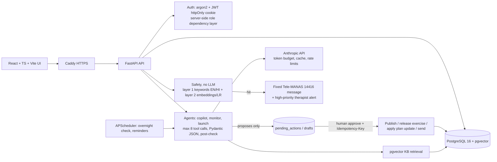
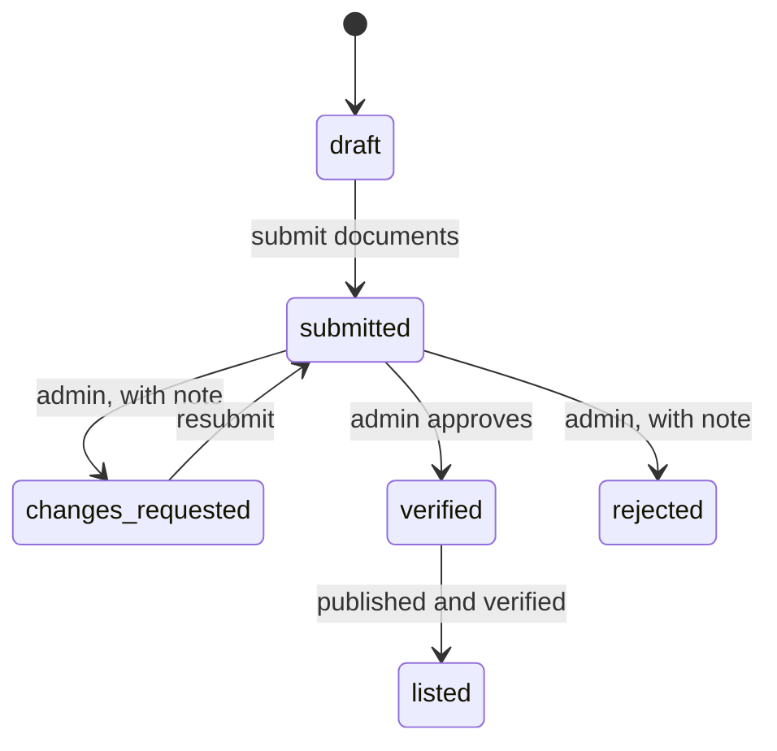

# Saarthi

Therapist-in-the-loop AI copilot and idea-to-launch flow for counselling practices. Practices publish a verified public page; clients book, check in, journal and do assigned exercises; therapists get a pre-session briefing, overnight monitoring and drafted plan updates. The AI only proposes: every output is a draft or pending action that an authenticated human approves before anything is published, released, applied or sent. Crisis detection runs without any LLM and always returns a fixed message with Tele-MANAS 14416.

   

**Live demo:** https://saarthi-cares.com. Reviewer access: see the hackathon submission.

## Key engineering decisions

- **AI only proposes.** Agent output is stored as a `pending_action` or draft. Publishing, releasing an exercise, applying a plan update and sending email each need an authenticated human action carrying an idempotency key, so retries cannot double-apply or double-send.
- **Access control is server-side.** Roles are enforced in a FastAPI dependency layer, never in prompts. Every endpoint has tests for cross-client, cross-therapist, owner-to-clinical and cross-client retrieval denial.
- **The crisis path uses no LLM.** Keyword and classifier layers run on all client free text and on PHQ-9 item 9 > 0, with no API key needed. A hit stops the flow, shows a fixed Tele-MANAS 14416 message and raises a high-priority therapist alert.
- **Deterministic post-check** on all AI output rejects diagnoses, medication or supplement advice (English and Hindi patterns) and unsupported practice claims, before a human sees it.
- **Bounded agent loop:** at most 8 tool calls, `max_tokens` set, Pydantic-validated JSON, one informed retry on validation failure, then a visible error. Client and note text enter prompts as delimited data with an instruction never to follow commands inside it.
- **Cost controls:** a daily token budget (a constant in `backend/app/agents/launch.py`, `TOKEN_BUDGET`) and per-IP rate limits. Over budget or AI down shows "AI unavailable, manual workflow open." and manual workflows keep working.
- **Verification pipeline with audit log.** Only published and verified practices and therapists are public. Admin decisions and document downloads are audited with actor and note.

## Architecture

Trust pipeline:

Editing a licence after verification returns the therapist to review. Verification never publishes or edits a practice page.

## Tech stack

| Layer | Technology |
|---|---|
| Backend | Python 3.12, FastAPI, Pydantic v2, SQLAlchemy 2, Alembic, APScheduler |
| Data | PostgreSQL 16 with pgvector |
| AI | Anthropic SDK (`MODEL_FAST=claude-haiku-5-5`, `MODEL_SMART=claude-sonnet-5-5`) |
| Retrieval and triage | fastembed `multilingual-e5-small`, scikit-learn logistic regression |
| Frontend | React, TypeScript, Vite, Tailwind, shadcn/ui |
| Auth | argon2 password hashing, JWT in an httpOnly cookie |
| Infrastructure | Docker Compose (caddy, api, postgres), automatic HTTPS |

## Features by role

| Role | Features |
|---|---|
| Client | Find and book verified therapists; intake; mood check-in; private or shared journal; guided journeys; assigned exercises; insights; English/Hindi; reminders. Crisis notice on every page |
| Therapist | Credentials and document submission; availability; bookings and intake; session notes (brain dump); AI briefing with cited knowledge; case plans and assessments; approve/reject exercise releases and plan updates; skill-building journeys; overnight alerts (plateau, low homework, untouched goal, risk) |
| Practice owner | Practice setup, editable AI-drafted page, document submission, therapist invites, bookings/listings and practice analytics. No clinical data |
| Admin | Verification queue for therapists and practices with completeness checks, review decisions, audit log, secure document download |

## Access-control matrix

| Data | Client | Therapist | Practice owner | Admin | Public |
|---|---|---|---|---|---|
| Own profile, mood, journal | own | n/a | n/a | no | no |
| Shared journal, mood trend, assessments, notes, plans | no | only clients with a booking or case plan with them | **never** | no | no |
| Other therapists' clients (same practice) | no | no | no | no | no |
| Practice page, listings, team, analytics | no | own practice view | own practice | all | published + verified only |
| Verification documents | no | own | own practice | all (audited) | no |
| Verification decisions | no | no | no | yes | no |
| Therapist directory | no | yes | yes | yes | verified only |

Enforced in a server-side dependency layer, never in prompts. Every endpoint has tests for cross-client, cross-therapist, owner-to-clinical and cross-client retrieval denial.

## Safety layers

- Layer 1: keyword and pattern match, English and Hindi (romanised and Devanagari).
- Layer 2: multilingual-e5-small embeddings with logistic regression, trained on 60 synthetic phrases.
- A hit from either layer triggers the fixed message and alert. No model text is in this path.

| Detector (held-out, 18 phrases) | Precision | Recall |
|---|---|---|
| Layer 1 only | 1.00 | 0.89 |
| Layer 2 only | 0.88 | 0.78 |
| Layer 1 OR layer 2 (deployed) | 0.90 | 1.00 |

Synthetic, 18 held-out phrases, not clinically validated. False alerts are accepted on purpose. Full method and caveats: [docs/EVALUATION.md](docs/EVALUATION.md).

## Quick start (local)

Prerequisites: Docker with Compose, GNU make. Node is needed only for `make e2e` and `make api-types`.

1. `cp .env.example .env`, then set `JWT_SECRET`. Set `ANTHROPIC_API_KEY` for live AI; leave it empty and the safety path and manual workflows still work.
2. `make up`, then `make seed` (idempotent; loads the knowledge base and 14 days of slots).
3. Open http://localhost (health: http://localhost/health). Seeded logins are in [docs/LOCAL_DEV.md](docs/LOCAL_DEV.md) and are for local use only.
4. `make test` runs pytest against Postgres after `alembic upgrade head`, with the LLM mocked. `make e2e` runs the Playwright story on http://localhost:8081. `make api-types` regenerates frontend types.

| Variable | Purpose | Default |
|---|---|---|
| `JWT_SECRET` | Signs session tokens; must be changed outside local use | `change-me-in-production` |
| `ANTHROPIC_API_KEY` | Live model calls | empty |
| `MODEL_FAST` / `MODEL_SMART` | Model IDs for dev and final runs | `claude-haiku-5-5` / `claude-sonnet-5-5` |
| `DEMO_MODE` | Local demo behaviour; 0 on the hosted site | `1` |
| `FAKE_LLM` | Canned model output for demos and e2e; the app refuses `1` with `DEMO_MODE=0` and `APP_ENV=production` | `0` |
| `SCHEDULER_ENABLED` | Reminders and overnight monitor | `0` |
| `OVERNIGHT_HOUR_UTC` | Hour of the overnight check | `21` |
| `SMTP_HOST`, `SMTP_PORT`, `SMTP_USER`, `SMTP_PASS`, `SMTP_FROM`, `SMTP_SECURE` | Outgoing email | local relay |
| `GODADDY_ALLOW_DNS_WRITE` | Allow DNS writes after owner confirmation | `0` |
| `TRUST_PROXY` | Trust `X-Forwarded-For` behind Caddy | `0` |

All other variables are documented in [.env.example](.env.example).

## Deployment

Docker Compose runs caddy, api and postgres; Caddy issues HTTPS certificates automatically for `DOMAIN`. `/opt/app/deploy.sh` pulls, builds, migrates and health-checks. A nightly cron job takes database and upload backups with 7-day retention. Secrets live only in the server's `.env`. See [DEPLOY.md](DEPLOY.md).

## Testing and evaluation

| Check | Result |
|---|---|
| Safety suite, 30 phrases EN/HI | risk 10/10 get the fixed message; benign 6/6 do not; 14/14 diagnosis, supplement and injection requests are not mistaken for risk, and 14/14 compliant model replies are rejected by the post-check |
| Claims bait (20 generated pages) | banned claims reaching the owner: 0/20; bait pages revised: 10/10 |
| Access control | cross-client, cross-therapist, owner-to-clinical and cross-client retrieval tests |
| RAG calibration | in-domain and out-of-domain similarities overlap; the threshold alone cannot gate near-miss queries |
| Overnight monitor | code flags plateau, low homework and untouched goals; the model only drafts wording |

Details, reproduction commands and caveats: [docs/EVALUATION.md](docs/EVALUATION.md).

## Hackathon: idea to launch

A practice owner describes their practice in a sentence. The launch agent proposes a page address (`/p/<slug>`), a draft page, a welcome email and a checklist as one pending action. The owner reviews and approves, an admin verifies the practice, and it goes live so clients can book inside Saarthi.

**Claude** powers the launch agent, the therapist copilot (briefings, plan-update and exercise proposals) and the overnight monitor. Output is schema-validated and post-checked.

**GoDaddy** is used for the domain, DNS, VPS hosting, business email over SMTP and the contact form. Owners who want their own domain get GoDaddy search links and the exact DNS records to add. DNS is written only when `GODADDY_ALLOW_DNS_WRITE=1` and the owner confirms; the app never buys a domain.

## Known limitations

- Serving a practice on its own domain is not built; pages are served at `/p/<slug>`.
- Domain availability is a link out to GoDaddy search, not a live check.
- The welcome email is a draft for the owner to send; Saarthi does not send it. Therapist invitation emails are sent over SMTP.
- Contact-form messages that look like a crisis are saved, not emailed.
- The daily token budget is a code constant and is not configurable by environment variable.
- The Hindi post-check is a word list, not a classifier, and will miss paraphrases.
- Risk triage is validated on a small synthetic set only; not clinically validated.
- Privacy and terms pages and translations are pending legal and linguistic review.

## Roadmap

**Product:** serve verified practices on their own domains; in-app welcome email sending; more regional languages; exercise swap in the approval inbox.
**Security and compliance:** DPDP Act compliance work; malware scanning for uploads; document cleanup on user deletion.
**Platform:** admin queue pagination and search; resend invite.
